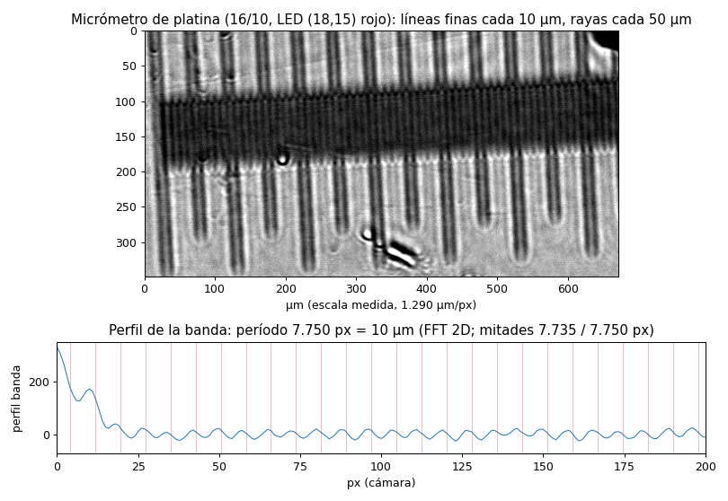
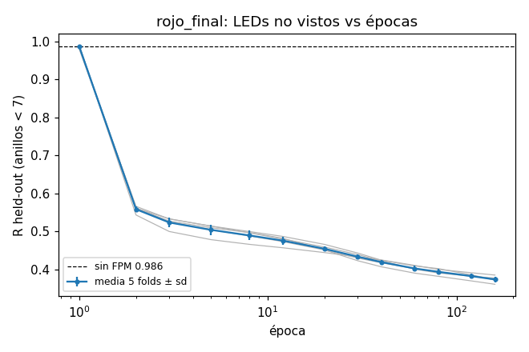
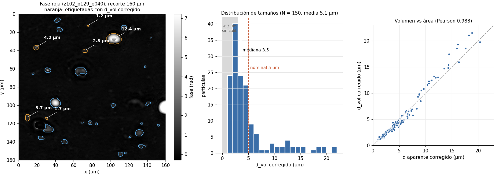
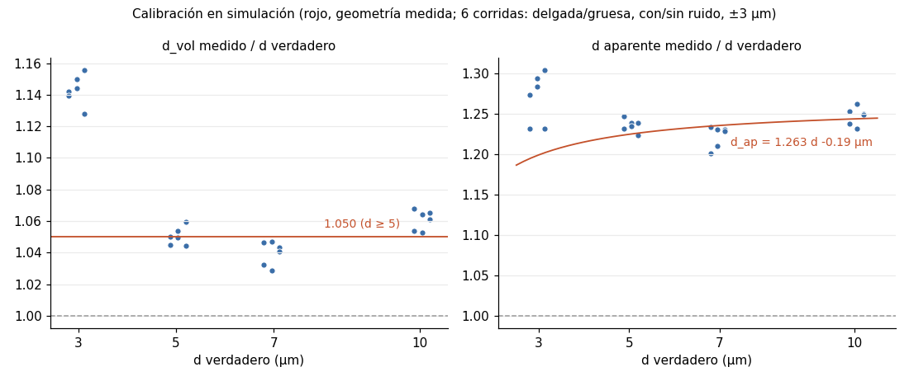
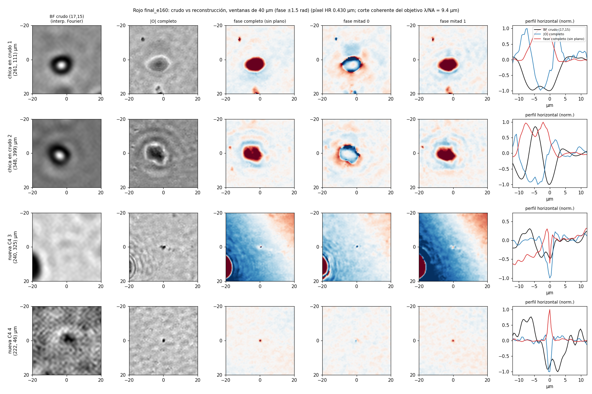
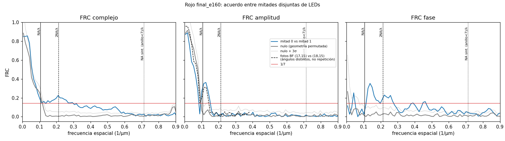

# Resultado rojo consolidado (octubre 2026)

Reconstrucción FPM del canal rojo (630 nm) de la captura 28/09b, con la geometría **medida**. Es el resultado firme del
proyecto a la fecha. Verde y azul quedan en pausa: ver "Lo que no funciona" al final.

## Resumen

- **Geometría medida con un micrómetro:** 1.290 µm/px en la muestra, aumento 2.48×. Con eso queda descartada la
  lectura de 2.28× que veníamos discutiendo.
- **Fase cuantitativa:** el volumen de fase de cada partícula da su tamaño. En 150 partículas, la media es 5.1 µm y
  el rango va de 1.2 a 21.5 µm, lo que coincide con lo nominal (media 5 µm, rango 1–20 µm). Calibrado en simulación,
  el error es de ~1 % para d ≥ 5 µm. La escala absoluta depende de un Δn supuesto.
- **Resolución:** hay una mejora reproducible sobre la foto cruda, pero es modesta y solo en fase y en el campo
  complejo. Las dos mitades de LEDs coinciden (FRC ≥ 1/7) hasta un período de 3.55 µm (NA efectiva 0.18), contra
  4.7 µm del límite de la foto cruda. Está lejos de la NA sintética que permite la geometría (0.45). El criterio
  pre-registrado de superresolución (C2) **sigue sin pasar**: 0.120 contra el umbral 0.143.

## 1. Geometría

**Micrómetro de platina** (captura 16/10, `scripts/calibracion_micrometro.py`):
- **Escala:** las líneas finas, cada 0.01 mm, aparecen cada **7.750 px**, medidas con una FFT 2D que corrige la
  inclinación de 2.6° de la regla.
- **Consistencia:** las dos mitades de la regla coinciden al 0.2 %, y las rayas, cada 0.05 mm, caen cada 5.03 líneas.
- **Resultado:** **1.290 µm/px → M = 2.48** con el pixel de 3.2 µm, que el laboratorio confirmó.
- **Campo reconstruido:** 400 × 400 px de cámara, es decir 516 µm de lado.

**Geometría de trabajo:**

| parámetro | valor | origen |
|---|---|---|
| pixel en la muestra | 1.29 µm | micrómetro |
| NA del objetivo | 0.067 | radio de pupila ajustado (nominal 0.07) |
| distancia LED–muestra z | 102 mm | ajuste; 98 ± 2 mm a mano |
| pitch de LED | 6 mm | placa, confirmado |
| offset del dado por color (rojo) | +1.06 mm | ajuste de campo plano (01/10) |

En código: preset `config.OBJECTIVES["2_5x_medido"]`, `config.WORKING_Z_DISTANCE_MM` y variante `rojo_final` en
`results/offset_color_2026-10-02/runner.py`.

**Residuo abierto.** El residuo sobre LEDs no vistas prefiere un paso angular de LED ~3 % más chico que el de esta
geometría (+0.010 ± 0.006 en rojo). Ya están descartados el pitch, el pixel y una inclinación de la placa (haría falta
~14°). Es chico frente al error de 2.28× (+0.07).

## 2. Reconstrucción

- **Método:** A+init (inicialización con el promedio de Fourier), factor de sobremuestreo 3 (pixel HR 0.43 µm,
  1200²). Se excluyen las LEDs (18,14) y (18,16), que quedan a horcajadas del borde de la pupila.
- **Época:** 160, elegida por el residuo sobre LEDs no vistas (5 folds), que baja sin estancarse:
  0.420 → 0.394 → 0.374 a 40 / 80 / 160 épocas. 160 es mejor que 80 en los 5 folds (−0.020 ± 0.006).

**Por qué más épocas es mejor acá, y cuándo no.**
- **El criterio no es el ajuste:** se mide sobre las fotos de LEDs que la reconstrucción **no usó** (held-out). Si
  hubiera sobreajuste, ese residuo empezaría a subir; en rojo baja en los 5 folds.
- **Lo confirma una señal independiente:** las dos mitades disjuntas de LEDs coinciden hasta 3.55 µm a 160 épocas,
  contra 4.07 µm a 40.
- **Vale para el rojo de esta captura, no en general.** El estudio de épocas del 30/09 (hasta 400,
  `docs/resultados_2026-09-30/iteraciones/`) ya lo mostraba:
  - **rojo:** mejora monótona hasta 400 épocas; 40 estaba a mitad de camino;
  - **verde y azul:** el mínimo del held-out está en ~5 épocas, después empeoran un poco y quedan planos. Es
    sobreajuste a **error de modelo**, no a ruido, coherente con su fase no cuantitativa (sección 5).
- **Ajustar mejor no garantiza una imagen más fiel.** Un error sistemático común a todas las LEDs, por ejemplo en el
  campo plano, también bajaría el residuo.
- **No todo mejora con las épocas:** el pico de fase crece (se sobreestima más) mientras el volumen queda estable. Por
  eso se mide el volumen (sección 3).
- **El óptimo no está ubicado:** a 160 épocas la curva todavía no se aplanó. Se eligió 160 porque es lo que se corrió.

## 3. Fase cuantitativa: tamaño de partículas

- **Diámetro desde el volumen de fase:** d_vol = ∛(6·V·λ / (2π·Δn·π)), con V la fase integrada sobre la partícula.
- **Calibración en simulación:** esferas de 3–10 µm, con modelo delgado y multicapa, pasadas por el mismo pipeline.
  - El volumen sobreestima el diámetro un factor **1.050** para d ≥ 5 µm; corregido, el residuo es 1 % (0.08 µm rms).
  - Para d = 3 µm el factor es 1.14, y por debajo de 3 µm no hay calibración.
- **Datos reales:** 150 partículas aisladas. Los tamaños se miden a 40 épocas, igual que la calibración, y valen
  también a 160 por la estabilidad de abajo.

  | mediana | rango intercuartil | media | rango | ≥ 5 µm | ≥ 10 µm |
  |---|---|---|---|---|---|
  | 3.5 µm | 2.4–5.2 µm | 5.1 µm | 1.2–21.5 µm | 41 | 21 |

- **Dos medidas independientes coinciden:** el tamaño por volumen y el tamaño por área concuerdan partícula a
  partícula (Pearson 0.988).
- **Estabilidad:** el tamaño de cada partícula cambia ±1 % entre 40 y 160 épocas. El pico de fase, en cambio, crece
  con las épocas, así que **la medida confiable es el volumen, no el pico**.
- **Δn:** se usó Δn = 0.0488, que **no está medido**. Un error de ±10 % en Δn cambia los tamaños en ∓3.4 %. Los datos
  sugieren un Δn efectivo algo mayor (~0.057), pero es un indicio, no una medición.

## 4. Resolución

**Límites teóricos:** foto cruda λ/2NA = 4.7 µm; corte coherente del objetivo λ/NA = 9.4 µm; NA sintética
0.45 → 1.4 µm.

| medida | período | NA efectiva |
|---|---|---|
| FRC complejo entre mitades ≥ 1/7 (época 160) | **3.55 µm** | 0.18 |
| FRC solo de fase ≥ 1/7 | 3.7 µm | — |
| FRC solo de amplitud (cae al nulo) | 5.8 µm | sin ganancia |
| dos fotos crudas de campo claro entre sí | 7.2 µm | — |
| señal sobre el nulo (débil, FRC 0.04–0.13) | hasta 1.6 µm | 0.39 |
| 40 épocas / geometría vieja (28/09b) | 4.07 / 4.52 µm | — |

**Criterios pre-registrados**, con las mismas definiciones que en `results/captura_2026-09-28b/criterios_b.py`:

| criterio | 28/09b (geometría vieja) | rojo final, época 160 |
|---|---|---|
| C1: residuo held-out frente a sin FPM | 0.461 → pasa | 0.374 contra 0.986 → pasa |
| C2: FRC en la banda [2NA/λ, 0.45], umbral 0.143 | 0.083 → falla | **0.120 → falla** (nulo 0.007) |
| C3: artefactos de la grilla de LEDs | pasa | 1.9e-3 → pasa |
| C4: partículas nuevas confirmadas en ambas mitades | 21 % → pasa | 28 % (azar 5.5 %) → pasa |

**Lectura.** FPM mejora la resolución en fase de forma reproducible, de 4.7 a 3.55 µm. Pero la amplitud no gana, la
mejora es una fracción chica de lo que permite la apertura sintética, y C2 no pasa. **Superresolución plena: no
demostrada.** Los puntos dispersores aislados miden ~1.3 µm en la reconstrucción, contra 4–6 µm en la foto cruda,
pero solo 3 de 60 aparecen claros en ambas mitades: es anecdótico.

## 5. Lo que no funciona: verde y azul

Verde y azul reconstruyen, pero su fase no es cuantitativa: les falta ~70 % (verde) y ~47 % (azul) del volumen de
fase. El 20/10 se descartaron cuatro causas:

| causa | resultado |
|---|---|
| geometría | con la geometría medida, los cocientes de volumen entre colores siguen lejos de lo esperado (0.66 / 1.08 contra 1.23 / 1.42) |
| grosor de las esferas | una simulación multicapa recupera el volumen igual que el modelo delgado |
| preprocesado | exposición, oscuros, campo plano, saturación y orden de LEDs, sin defectos |
| desenfoque residual | reenfocar las reconstrucciones no recupera volumen |

Lo que se puede afirmar es que verde y azul nunca alcanzan el contraste de amplitud bajo que tiene el rojo en foco.
Para separar el problema, la próxima captura debería incluir una muestra de referencia conocida (target USAF o esferas
chicas).

## Fuentes

- **Calibración:** `docs/resultados_2026-10-20/` (micrómetro, barrido de paso, held-out 1.29 contra 1.25).
- **En `results/`** (no versionado; lo esencial copiado arriba):
  - `offset_color_2026-10-02/` (`INFORME.md`, `runner.py`, `rojo_final_20oct.sh`);
  - `rojo_fase_2026-10-20/`, `rojo_resolucion_2026-10-20/`;
  - `sim_grueso_2026-10-20/`, `auditoria_gb_2026-10-20/`.
